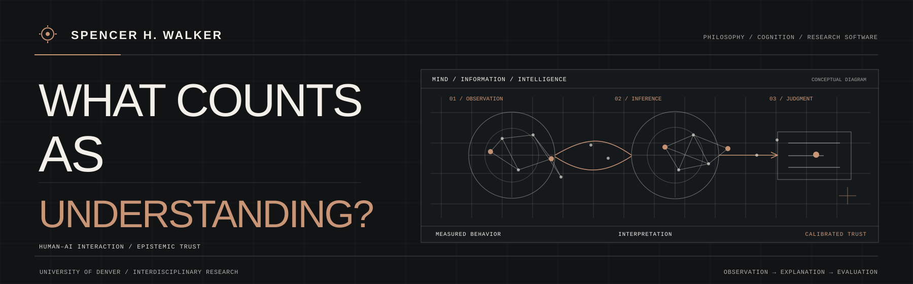

  

# Spencer H. Walker

I study **philosophy at the University of Denver**, with a focus on philosophy of mind, epistemology, and the relationship between human cognition and artificial intelligence. My earlier **B.S. in Neuroscience & Cognitive Science from the University of Arizona** informs an interdisciplinary approach that connects philosophical questions with empirical methods and research software.

Much of my work asks what it means for an AI system to *appear* intelligent, how we assess what it actually does, and when people are justified in trusting its responses. I also founded **[Nurowerx](https://github.com/Nurowerx)**, where I work on research and technical development in intelligent systems.

## Research focus: human–AI understanding and trust

**When AI appears to understand, what evidence justifies that impression?**

My proposed interdisciplinary research examines the difference between an AI system's **observable reliability** and a person's **perception of its intelligence and trustworthiness**. Three connected questions shape the work:

- **Conversational memory:** When does accurate use of prior context improve performance, and when can incorrect memory create misleading inferences?
- **Conversational realism:** How do naturalistic speech and contextual inference affect perceived competence, independently of task accuracy?
- **Calibrated trust:** Can explanations, uncertainty, source attribution, and meaningful correction help people judge AI outputs more appropriately?

This is a **research proposal in development**, not a report of completed participant studies or published experimental findings.

Explore the [research profile](https://github.com/SWALKERNURO/living-field/blob/main/RESEARCH-PROFILE.md), [research agenda](https://github.com/SWALKERNURO/living-field/blob/main/research/HUMAN-AI-INTERACTION-AGENDA.md), and [proposed study design](https://github.com/SWALKERNURO/living-field/blob/main/research/HUMAN-AI-INTERACTION-STUDY-DESIGN.md).

## Selected research software

| Project | Research purpose |
| :--- | :--- |
| **[Living Field](https://github.com/SWALKERNURO/living-field)** | Exploratory EEG/EOG visualization, aperiodic signal structure, and comparisons across recording conditions. |
| **[Pink Noise Relational Field / NoiseColor](https://github.com/SWALKERNURO/pink-noise-relational-field)** | EEG/EOG visualization and a local-first tool for exploring audio spectral color. [Try NoiseColor](https://swalkernuro.github.io/pink-noise-relational-field/noisecolor/). |
| **[Flux EEG](https://github.com/SWALKERNURO/flux-eeg)** | Local-first EEG spectral analysis and condition comparisons, with reproducible outputs and inspectable methods. |
| **[Resident Model Lab](https://github.com/Nurowerx/resident-model-lab)** · Nurowerx | Experimental router-faithful MoE expert residency and constrained-GPU inference. **Selection v2:** 38.3% less peak GPU tensor memory versus the prior 256-slot cache, with 11.4% greater latency; **128/128** tested requests matched reference tokens. [Public research note](https://github.com/Nurowerx/.github/blob/main/profile/research/RESIDENT-MODEL-LAB.md). **Repository private**; findings limited to the tested setup. |

The neuroscience tools are **exploratory research instruments**, not clinical or diagnostic products or validated measures of consciousness. For Resident Model Lab, the measured **GPU tensor allocation** tradeoff and bounded output-fidelity checks are reported separately from unproven general claims about full-system memory, speed, hardware cost, or capability preservation.

## Background and technical training

My academic and technical interests bring together philosophical argument, cognitive science, scientific computing, and AI systems. I favor reproducible methods, careful attribution of evidence, explicit uncertainty, and human oversight in the design of intelligent systems.

<strong>Selected AI and software coursework and certificates</strong>

- [Harvard CS50: Introduction to Artificial Intelligence with Python](https://cs50.harvard.edu/certificates/0d86c122-ee78-41d1-a2a1-274c6548ac1c) — completed 12 projects.
- [Hugging Face Agents Course](https://huggingface.co/agents-course) — Certificate of Excellence.
- [University of Helsinki: Full Stack Open](https://studies.cs.helsinki.fi/stats/api/certificate/fullstackopen/en/30bf26e52f85fb19c9458e01a077db9a).
- [University of Helsinki: Ethics of AI](https://certificates.mooc.fi/validate/zt7sc83r99t).
- [UNESCO / LG AI Research: Global MOOC on the Ethics of AI](https://coursera.org/verify/LO9X8AT36AFM).
- [Microsoft / freeCodeCamp: Foundational C# Developer Certification](https://freecodecamp.org/certification/shwalker/foundational-c-sharp-with-microsoft).

## Connect

My [ORCID research record](https://orcid.org/0009-0005-3574-1057) provides a scholarly identity separate from my company work. You can also explore [Nurowerx's research directions](https://github.com/Nurowerx) or contact me at [swalker@nurowerx.com](mailto:swalker@nurowerx.com).

University of Denver identifies my current enrollment and academic context; it does not imply university funding, sponsorship, ethics approval, or endorsement of independent research proposals.
